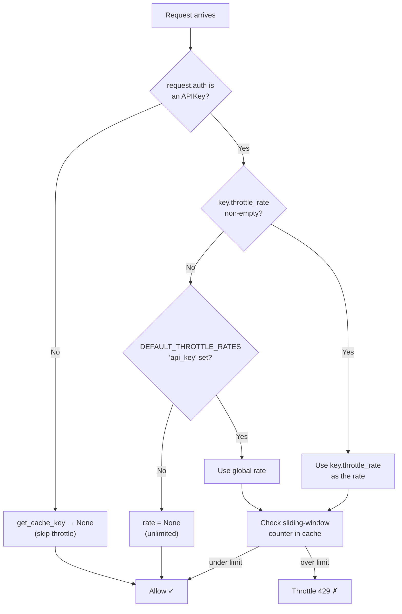

`APIKeyRateThrottle` limits how many requests each API key can make per time
window, using DRF's built-in sliding-window cache. The counter is tracked
**per key**, not per user or per IP — two keys belonging to the same user each
get their own independent budget.

## Setup

Add `APIKeyRateThrottle` to your DRF throttle classes:

```python
# settings.py
REST_FRAMEWORK = {
    "DEFAULT_THROTTLE_CLASSES": [
        "drf_simple_apikey.throttling.APIKeyRateThrottle",
    ],
    "DEFAULT_THROTTLE_RATES": {
        "api_key": "100/hour",   # global fallback for all API keys
    },
}
```

Or apply it to a single view:

```python
from drf_simple_apikey.throttling import APIKeyRateThrottle

class YourViewSet(viewsets.ViewSet):
    throttle_classes = [APIKeyRateThrottle]
```

## Rate resolution order

For each request, `APIKeyRateThrottle` determines the effective rate like this:

1. **Per-key `throttle_rate`** — if the authenticating `APIKey` row has a
   non-empty `throttle_rate` field (e.g. `"50/hour"`), that rate is used.
2. **Global `api_key` scope** — if `throttle_rate` is empty, the value from
   `DEFAULT_THROTTLE_RATES["api_key"]` is used.
3. **No throttling** — if neither is set, the request is always allowed.

Requests that were **not** authenticated with an API key (anonymous requests)
are **never** counted or blocked by this throttle. Combine it with
[`AnonRateThrottle`](https://www.django-rest-framework.org/api-guide/throttling/#anonratethrottle)
if you also want to limit unauthenticated traffic.

## Per-key rate override

Set a custom rate directly on an individual `APIKey` instance. The format
mirrors DRF's `SimpleRateThrottle`: `"<count>/<period>"`, where the period is
any string starting with `s`, `m`, `h`, or `d`:

| Example value | Meaning |
|---------------|---------|
| `100/hour`    | 100 requests per hour |
| `10/minute`   | 10 requests per minute |
| `1/second`    | 1 request per second |
| `5000/day`    | 5 000 requests per day |
| `""` (empty)  | Use the global `api_key` rate |

```python
from drf_simple_apikey.models import APIKey

api_key, key = APIKey.objects.create_api_key(
    entity=user,
    throttle_rate="50/hour",   # this key gets a tighter limit than the global one
)
```

You can also update an existing key:

```python
api_key.throttle_rate = "200/hour"
api_key.full_clean()   # runs the validator
api_key.save()
```

### Validation

The `throttle_rate` field is validated on save. Invalid values raise a
`django.core.exceptions.ValidationError`:

```python
api_key.throttle_rate = "not-a-rate"
api_key.full_clean()   # raises ValidationError
```

## Combining with other throttles

`APIKeyRateThrottle` plays well alongside other DRF throttle classes. For
example, to enforce a per-key limit **and** a global anonymous limit:

```python
REST_FRAMEWORK = {
    "DEFAULT_THROTTLE_CLASSES": [
        "drf_simple_apikey.throttling.APIKeyRateThrottle",
        "rest_framework.throttling.AnonRateThrottle",
    ],
    "DEFAULT_THROTTLE_RATES": {
        "api_key": "1000/day",
        "anon": "20/hour",
    },
}
```

## How it works



> [!NOTE]
> The cache key is scoped to `api_key.<pk>`, so each key has its own counter
> independent of the user, IP address, or view being called.

> [!TIP]
> Leave `throttle_rate` empty on most keys and set `DEFAULT_THROTTLE_RATES["api_key"]`
> as your default. Use per-key overrides only for keys that need a different limit
> (e.g. a trusted partner key that gets a higher quota).

